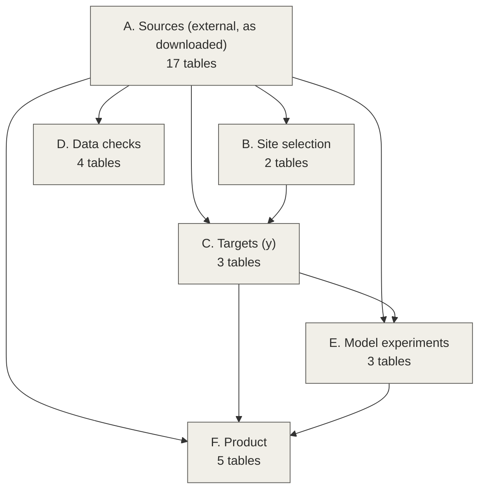
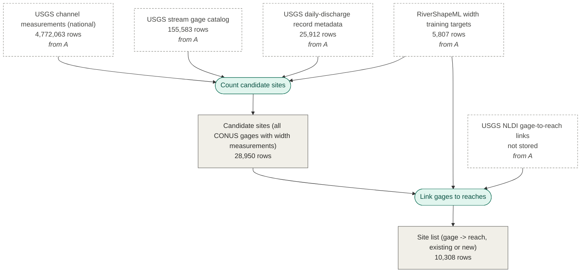
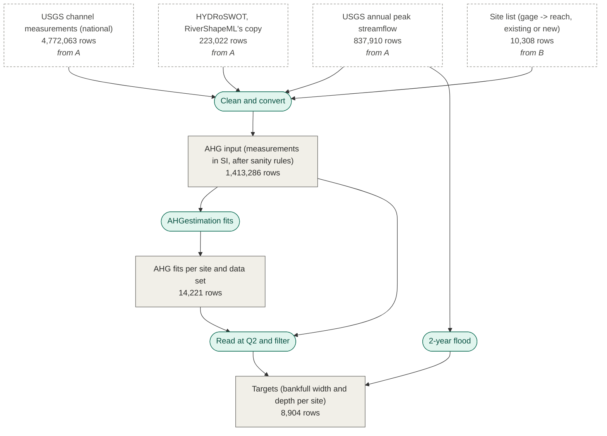
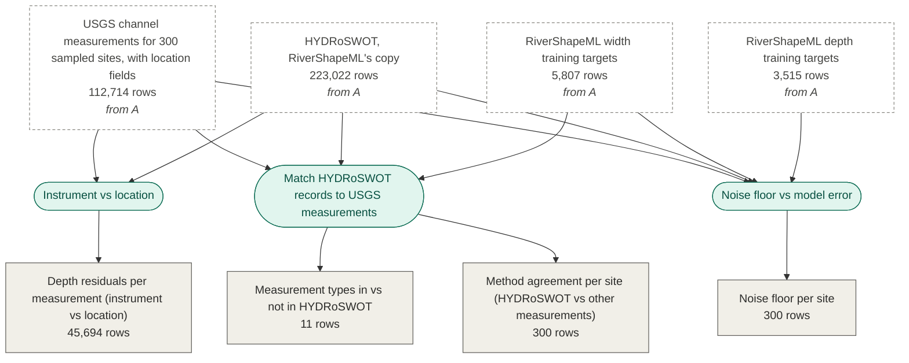
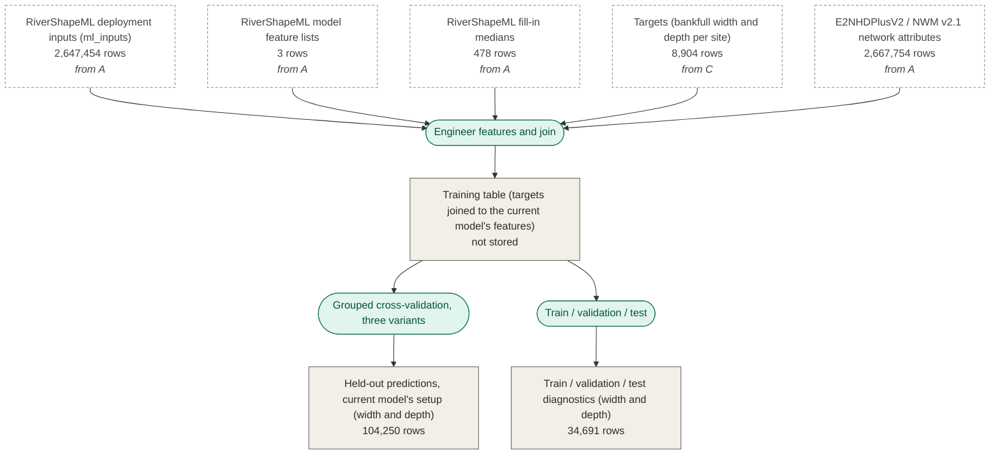

# Data lineage

Every table in the final pipeline, where it came from, and the math connecting them.
Generated by `src/data_lineage.py` from `docs/data_lineage.yaml`; row counts are live.

## Overview

## A. Sources (external, as downloaded)

```mermaid
flowchart TD
  bieger_curves["Bieger et al. (2015) regional bankfull curves applied per reach<br/>2,699,864 rows"]:::table
  e2nhdplus["E2NHDPlusV2 / NWM v2.1 network attributes<br/>2,667,754 rows"]:::table
  hydroshare_2024["RiverShapeML 2024 release (ML-derived channel width and depth)<br/>2,712,021 rows"]:::table
  hydroswot["HYDRoSWOT, RiverShapeML's copy<br/>223,022 rows"]:::table
  ml_inputs["RiverShapeML deployment inputs (ml_inputs)<br/>2,647,454 rows"]:::table
  nldi_gage_reach_links["USGS NLDI gage-to-reach links<br/>not stored"]:::table
  riverml_feature_lists["RiverShapeML model feature lists<br/>3 rows"]:::table
  riverml_fill_medians["RiverShapeML fill-in medians<br/>478 rows"]:::table
  riverml_models["RiverShapeML deployed models and model files<br/>3 rows"]:::table
  rsml_depth_targets["RiverShapeML depth training targets<br/>3,515 rows"]:::table
  rsml_width_targets["RiverShapeML width training targets<br/>5,807 rows"]:::table
  silverway_measurements["USGS channel measurements at Shoal Ck at Silverway Dr (08156675)<br/>145 rows"]:::table
  usgs_channel_measurements["USGS channel measurements (national)<br/>4,772,063 rows"]:::table
  usgs_channel_measurements_by_site["USGS channel measurements for 300 sampled sites, with location fields<br/>112,714 rows"]:::table
  usgs_monitoring_locations["USGS stream gage catalog<br/>155,583 rows"]:::table
  usgs_peaks["USGS annual peak streamflow<br/>837,910 rows"]:::table
  usgs_ts_meta["USGS daily-discharge record metadata<br/>25,912 rows"]:::table
  classDef table fill:#F1EFE8,stroke:#5F5E5A,color:#2C2C2A
  classDef external fill:#ffffff,stroke:#888780,stroke-dasharray:4 3,color:#444441
  classDef op fill:#E1F5EE,stroke:#0F6E56,color:#085041
```

### Tables

#### USGS channel measurements (national) (`usgs_channel_measurements`)

- **Path:** `data/raw/channel_meas/page_*.parquet`
- **Rows:** 4,772,063
- **Grain:** one channel of one streamflow measurement visit
- **Key:** monitoring_location_id, time, channel_name
- **Source / provenance:**
  - **provider:** USGS Water Data APIs (OGC API - Features)
  - **endpoint:** https://api.waterdata.usgs.gov/ogcapi/v0/collections/channel-measurements/items
  - **query:** properties=monitoring_location_id,time,channel_flow,channel_width,channel_area,measurement_type,channel_name; paged 20,000 rows by cursor
  - **retrieved:** 2026-10-14
  - **script:** src/fetch_usgs_ogc.py channel-measurements
  - **notes:** ~14 records the server could not return were stepped over (logged in data/raw/channel_meas/log.txt)
- **Columns:**
  - `monitoring_location_id`: text; USGS-<site number>
  - `time`: UTC timestamp; measurement time
  - `channel_flow`: ft3/s; measured discharge
  - `channel_width`: ft; water-surface width
  - `channel_area`: ft2; cross-section area
  - `measurement_type`: text; Wading, BridgeDownstreamSide, MannedMovingBoat, Cableway, Ice, ...
  - `channel_name`: text; channel label when a measurement has several channels

#### USGS channel measurements for 300 sampled sites, with location fields (`usgs_channel_measurements_by_site`)

- **Path:** `data/raw/channel_meas_by_site/*.parquet`
- **Rows:** 112,714
- **Grain:** one channel of one measurement visit, at 300 randomly sampled width-training sites (seed 1)
- **Key:** monitoring_location_id, time, channel_name
- **Source / provenance:**
  - **provider:** USGS Water Data APIs
  - **endpoint:** https://api.waterdata.usgs.gov/ogcapi/v0/collections/channel-measurements/items
  - **query:** monitoring_location_id=USGS-<site>; adds channel_location_distance, channel_location_direction, channel_material, channel_stability
  - **retrieved:** 2026-10-15
  - **script:** src/method_agreement.py (fetch)
- **Columns:**
  - `channel_location_distance`: ft; distance of the measurement section from the gage
  - `channel_location_direction`: text; Upstream, Downstream, AtTheGage
  - `channel_material`: text; bed material
  - `channel_stability`: text; channel stability
  - `(others)`: as usgs_channel_measurements

#### USGS annual peak streamflow (`usgs_peaks`)

- **Path:** `data/raw/peaks/page_*.parquet`
- **Rows:** 837,910
- **Grain:** one gage-water year
- **Key:** monitoring_location_id, water_year
- **Source / provenance:**
  - **provider:** USGS Water Data APIs
  - **endpoint:** https://api.waterdata.usgs.gov/ogcapi/v0/collections/peaks/items
  - **query:** parameter_code=00060 (discharge); properties=monitoring_location_id,value,water_year,qualifier
  - **retrieved:** 2026-10-15
  - **script:** src/fetch_usgs_ogc.py peaks
- **Columns:**
  - `value`: ft3/s; instantaneous annual peak discharge
  - `water_year`: year; October-September water year
  - `qualifier`: text; USGS peak qualification codes (not used)

#### USGS stream gage catalog (`usgs_monitoring_locations`)

- **Path:** `data/raw/monitoring_locations/page_*.parquet`
- **Rows:** 155,583
- **Grain:** one stream site
- **Key:** id
- **Source / provenance:**
  - **provider:** USGS Water Data APIs
  - **endpoint:** https://api.waterdata.usgs.gov/ogcapi/v0/collections/monitoring-locations/items
  - **query:** site_type_code=ST; with point geometry
  - **retrieved:** 2026-10-15
  - **script:** src/fetch_usgs_ogc.py monitoring-locations
- **Columns:**
  - `id`: text; USGS-<site number>
  - `state_code`: text; FIPS state code (CONUS filter)
  - `drainage_area`: mi2; drainage area (x 2.58999 -> km2)
  - `lon`: degrees; longitude
  - `lat`: degrees; latitude

#### USGS daily-discharge record metadata (`usgs_ts_meta`)

- **Path:** `data/raw/ts_meta/page_*.parquet`
- **Rows:** 25,912
- **Grain:** one time series at one site
- **Key:** monitoring_location_id, parameter_code, statistic_id
- **Source / provenance:**
  - **provider:** USGS Water Data APIs
  - **endpoint:** https://api.waterdata.usgs.gov/ogcapi/v0/collections/time-series-metadata/items
  - **query:** parameter_code=00060 (discharge), statistic_id=00003 (daily mean)
  - **retrieved:** 2026-10-14
  - **script:** src/fetch_usgs_ogc.py time-series-metadata
- **Columns:**
  - `begin`: date; first daily value
  - `end`: date; last daily value

#### USGS NLDI gage-to-reach links (`nldi_gage_reach_links`)

- **Path:** `None`
- **Rows:** not stored
- **Grain:** one gage
- **Key:** site_no
- **Source / provenance:**
  - **provider:** USGS Network-Linked Data Index (NLDI)
  - **endpoint:** https://api.water.usgs.gov/nldi/linked-data/nwissite/USGS-<site>?f=json
  - **retrieved:** 2026-10-15
  - **script:** src/site_comids.py (nldi_comid)
- **Columns:**
  - `comid`: integer; NHDPlusV2 reach the gage is indexed to (null when not indexed)

#### USGS channel measurements at Shoal Ck at Silverway Dr (08156675) (`silverway_measurements`)

- **Path:** `data/raw/usgs_channel-measurements_08156675.json`
- **Rows:** 145
- **Grain:** one channel of one measurement visit at one gage
- **Key:** time, channel_name
- **Source / provenance:**
  - **provider:** USGS Water Data APIs
  - **endpoint:** https://api.waterdata.usgs.gov/ogcapi/v0/collections/channel-measurements/items
  - **query:** monitoring_location_id=USGS-08156675 (all properties)
  - **retrieved:** 2026-10-14
  - **script:** src/silverway.py (downloads if missing)
- **Columns:**
  - `(all)`: as usgs_channel_measurements, all properties

#### HYDRoSWOT, RiverShapeML's copy (`hydroswot`)

- **Path:** `data/raw/repo/RiverShapeML/data/adcp.parquet`
- **Rows:** 223,022
- **Grain:** one ADCP measurement
- **Key:** site_no, site_visit_start_dt
- **Source / provenance:**
  - **provider:** lynker-spatial/RiverShapeML (copy of USGS HYDRoSWOT; Canova et al. 2016, doi:10.5066/F7D798H6)
  - **endpoint:** https://github.com/lynker-spatial/RiverShapeML
  - **version:** commit 29c1209cf5396ebf06f53578a32ad2a8cf70ab0f
  - **retrieved:** 2026-10-14
  - **script:** get_data.sh
- **Columns:**
  - `site_no`: text; USGS site number
  - `site_visit_start_dt`: datetime; measurement time (local)
  - `meas_q_va`: ft3/s; discharge
  - `stream_wdth_va`: ft; width
  - `max_depth_va`: ft; maximum depth (mostly missing; no cross-section area)

#### RiverShapeML width training targets (`rsml_width_targets`)

- **Path:** `data/raw/repo/RiverShapeML/data/nwis_width_pred_tar_up.parquet`
- **Rows:** 5,807
- **Grain:** one training site
- **Key:** siteID
- **Source / provenance:**
  - **provider:** lynker-spatial/RiverShapeML
  - **version:** commit 29c1209cf5396ebf06f53578a32ad2a8cf70ab0f
  - **retrieved:** 2026-10-14
  - **script:** get_data.sh
- **Columns:**
  - `siteID`: text; USGS site number (defines 'existing' sites)
  - `COMID`: integer; NHDPlusV2 reach
  - `bf_ff`: ft3/s; their bankfull (2-year) flood, fitted from NWIS records
  - `in_ff`: ft3/s; their in-channel (100% annual exceedance) flood
  - `TW_bf`: ft; their bankfull width target
  - `R2`: -; their AHG fit R2 (training uses R2 > 0.6)
  - `meas_q_va`: ft3/s; largest measured flow

#### RiverShapeML depth training targets (`rsml_depth_targets`)

- **Path:** `data/raw/repo/RiverShapeML/data/nwis_depth_pred_tar_up.parquet`
- **Rows:** 3,515
- **Grain:** one training site
- **Key:** siteID
- **Source / provenance:**
  - **provider:** lynker-spatial/RiverShapeML
  - **version:** commit 29c1209cf5396ebf06f53578a32ad2a8cf70ab0f
  - **retrieved:** 2026-10-14
  - **script:** get_data.sh
- **Columns:**
  - `Y_bf`: ft; their bankfull depth target (spread used for the model-error estimate in noise_floor)

#### RiverShapeML deployment inputs (ml_inputs) (`ml_inputs`)

- **Path:** `data/raw/predict-riverML/data/ml_inputs.parquet`
- **Rows:** 2,647,454
- **Grain:** one NHDPlusV2 reach
- **Key:** FEATUREID
- **Source / provenance:**
  - **provider:** NOAA-OWP/predict-riverML (68 xz parts, reassembled with cat | xz -d as their deploy.bash does)
  - **endpoint:** https://github.com/NOAA-OWP/predict-riverML
  - **version:** commit 34302969af21172dd0b80f23cc9a1b003dd0a6ea
  - **retrieved:** 2026-10-15
  - **script:** get_data.sh
- **Columns:**
  - `FEATUREID`: integer; NHDPlusV2 COMID
  - `bf_ff`: m3/s-scale NWM v2.1 2-year flood (their units; used only through their feature engineering)
  - `nwm_max`: NWM maximum flow (their units)
  - `19 raw columns used`: slope, TotDASqKM (km2), LAI, RckDepWs, qsb_tavg, Sinuosity, flowline_type, lat, long, suggested_width_m (m), BFIWs, ArbolateSu, StreamOrde, WtDepWs, roughness, elevation_diff (167 columns in total)

#### RiverShapeML deployed models and model files (`riverml_models`)

- **Path:** `data/raw/predict-riverML/models/*.pickle.dat`
- **Rows:** 3
- **Grain:** one trained model (TW_bf, Y_bf, r)
- **Key:** target
- **Source / provenance:**
  - **provider:** NOAA-OWP/predict-riverML
  - **version:** commit 34302969af21172dd0b80f23cc9a1b003dd0a6ea
  - **retrieved:** 2026-10-15
  - **script:** get_data.sh
  - **notes:** with model_space/final_model_features_<target>.json (30 features, in order) and model_space/metrics/median_imput_<target>.parquet (fill-in medians)
- **Columns:**
  - `XGBRegressor`: TW_bf: 9,765 trees; Y_bf: 11,000; learning rate 0.01, depth 9, subsample 0.8, colsample 0.7

#### RiverShapeML model feature lists (`riverml_feature_lists`)

- **Path:** `data/raw/predict-riverML/model_space/final_model_features_*.json`
- **Rows:** 3
- **Grain:** one model (TW_bf, Y_bf, r)
- **Key:** target
- **Source / provenance:**
  - **provider:** NOAA-OWP/predict-riverML
  - **version:** commit 34302969af21172dd0b80f23cc9a1b003dd0a6ea
  - **retrieved:** 2026-10-15
  - **script:** get_data.sh
- **Columns:**
  - `(list)`: the 30 engineered features each model expects, in order

#### RiverShapeML fill-in medians (`riverml_fill_medians`)

- **Path:** `data/raw/predict-riverML/model_space/metrics/median_imput_*.parquet`
- **Rows:** 478
- **Grain:** one input feature per model
- **Key:** target, feature
- **Source / provenance:**
  - **provider:** NOAA-OWP/predict-riverML
  - **version:** commit 34302969af21172dd0b80f23cc9a1b003dd0a6ea
  - **retrieved:** 2026-10-15
  - **script:** get_data.sh
- **Columns:**
  - `Median`: feature units; value used to fill missing inputs before feature engineering

#### RiverShapeML 2024 release (ML-derived channel width and depth) (`hydroshare_2024`)

- **Path:** `data/raw/rivershapeml/ml_channel_dimension.parquet`
- **Rows:** 2,712,021
- **Grain:** one reach (reach IDs repeat: ~65k duplicates, collapsed to their median when used)
- **Key:** hf_id
- **Source / provenance:**
  - **provider:** HydroShare, Modaresi Rad et al.
  - **endpoint:** https://www.hydroshare.org/resource/d147fcf554a54b2aaa4f146f85da0e03/
  - **version:** last updated 2024-08-23
  - **retrieved:** 2026-10-14
  - **script:** get_data.sh
- **Columns:**
  - `hf_id`: integer; reference-fabric reach ID (= NHDPlusV2 COMID)
  - `tw_bf(m)`: m; bankfull width
  - `y_bf(m)`: m; bankfull depth
  - `tw_inchan(m)`: m; in-channel width
  - `y_inchan(m)`: m; in-channel depth

#### Bieger et al. (2015) regional bankfull curves applied per reach (`bieger_curves`)

- **Path:** `data/raw/bieger/BANKFULL_CONUS.txt`
- **Rows:** 2,699,864
- **Grain:** one NHDPlusV2 reach
- **Key:** COMID
- **Source / provenance:**
  - **provider:** USGS ScienceBase, "Select Hydrologic Attributes - Bankfull Hydraulic Geometry Related to Physiographic Divisions"
  - **endpoint:** https://www.sciencebase.gov/catalog/item/5cf02bdae4b0b51330e22b85
  - **version:** doi:10.5066/F7765D7V
  - **retrieved:** 2026-10-15
  - **script:** get_data.sh
- **Columns:**
  - `BANKFULL_WIDTH`: m; from drainage area by physiographic division (-9999 = no data)
  - `BANKFULL_DEPTH`: m
  - `BANKFULL_XSEC_AREA`: m2 (not used)

#### E2NHDPlusV2 / NWM v2.1 network attributes (`e2nhdplus`)

- **Path:** `data/raw/enhd/enhd_nhdplusatts.parquet`
- **Rows:** 2,667,754
- **Grain:** one NHDPlusV2 reach
- **Key:** comid
- **Source / provenance:**
  - **provider:** USGS ScienceBase, "Updated CONUS river network attributes based on the E2NHDPlusV2 and NWMv2.1 networks (ver. 2.0)"
  - **endpoint:** https://www.sciencebase.gov/catalog/item/63cb311ed34e06fef14f40a3
  - **retrieved:** 2026-10-15
  - **script:** get_data.sh
- **Columns:**
  - `comid`: integer; reach ID
  - `tocomid`: integer; downstream reach
  - `levelpathi`: integer; river (level path) ID
  - `totdasqkm`: km2; total drainage area
  - `streamorde`: -; Strahler stream order
  - `slope`: m/m
  - `roughness`: -; Manning's n
  - `arbolatesu`: km; arbolate sum
  - `gnis_name`: text; river name

## B. Site selection

### Tables

#### Candidate sites (all CONUS gages with width measurements) (`candidate_sites`)

- **Path:** `data/derived/new_rows_sites.csv`
- **Rows:** 28,950
- **Grain:** one gage with >= 1 usable width measurement since 2000
- **Key:** site_no
- **Source / provenance:**
  - **script:** src/new_rows.py
- **Columns:**
  - `n_meas`: count; measurements since 2000 with Q > 0, W > 0, not ice
  - `conus`: bool
  - `da_km2`: km2; drainage area
  - `flow_years`: years; longest daily-discharge record
  - `in_training`: bool; in rsml_width_targets

#### Site list (gage -> reach, existing or new) (`retrain_sites`)

- **Path:** `data/derived/retrain_sites.csv`
- **Rows:** 10,308
- **Grain:** one gage
- **Key:** site_no
- **Source / provenance:**
  - **script:** src/site_comids.py
- **Columns:**
  - `group`: text; existing (in RiverShapeML's training targets) or new
  - `comid`: integer; NHDPlusV2 reach (RiverShapeML's for existing, NLDI for new; null if unlinked)

### Operations

#### Count candidate sites (`count_candidates`)

- **Script:** `src/new_rows.py`
- **In:** `usgs_channel_measurements`, `usgs_monitoring_locations`, `usgs_ts_meta`, `rsml_width_targets`
- **Out:** `candidate_sites`
- **Math:**
  - n_meas = number of measurements since 2000 with Q > 0, W > 0, not under ice
  - flow_years = max over daily-mean discharge series of (end - begin) / 365.25
  - candidate (new) = CONUS and not in RiverShapeML's targets and n_meas >= 5 and flow_years >= 10

#### Link gages to reaches (`link_reaches`)

- **Script:** `src/site_comids.py`
- **In:** `candidate_sites`, `rsml_width_targets`, `nldi_gage_reach_links`
- **Out:** `retrain_sites`
- **Math:**
  - existing sites: comid = RiverShapeML's COMID
  - new sites: comid = NLDI comid for the gage (null if the gage is not indexed)

## C. Targets (y)

### Tables

#### AHG input (measurements in SI, after sanity rules) (`ahg_input`)

- **Path:** `data/derived/ahg_input.parquet`
- **Rows:** 1,413,286
- **Grain:** one measurement at a site with a reach and a 2-year flood
- **Key:** site_no, set, row
- **Source / provenance:**
  - **script:** src/build_targets.py (load_measurements)
- **Columns:**
  - `set`: text; all (every USGS method, 2000+) or hs (HYDRoSWOT records, 2000-2015)
  - `Q`: m3/s; discharge
  - `TW`: m; top width
  - `Y`: m; mean depth (null for hs)
  - `V`: m/s; mean velocity (null for hs)

#### AHG fits per site and data set (`ahg_fits`)

- **Path:** `data/derived/ahg_fits.parquet`
- **Rows:** 14,221
- **Grain:** one site x data set (all, hs)
- **Key:** site_no, set
- **Source / provenance:**
  - **script:** src/ahg_fit.R (AHGestimation commit in r_ahg_commit.txt)
- **Columns:**
  - `n_in`: count; measurements in
  - `n_used`: count; after mad_filter and qva_filter
  - `TW_coef`: a; W = a Q^b (m, m3/s)
  - `TW_exp`: b; -
  - `Y_coef`: c; D = c Q^f
  - `Y_exp`: f; -
  - `V_coef`: k; V = k Q^m
  - `V_exp`: m; -
  - `viable`: bool; meets continuity (a c k ~ 1, b + f + m ~ 1) within 5%
  - `error`: text; why a fit failed (e.g. < 5 measurements after filtering)

#### Targets (bankfull width and depth per site) (`targets`)

- **Path:** `data/derived/retrain_targets.csv`
- **Rows:** 8,904
- **Grain:** one gage
- **Key:** site_no
- **Source / provenance:**
  - **script:** src/build_targets.py
- **Columns:**
  - `q2`: ft3/s; 2-year flood
  - `n_peaks`: count; annual peaks
  - `tw_all`: ft; bankfull width, all measurements (null if filtered out)
  - `td_all`: ft; bankfull mean depth, all measurements
  - `tw_hs`: ft; bankfull width, HYDRoSWOT only
  - `se_all / se_d_all / se_hs`: log units; standard error of the log target at Q2
  - `ext_all / ext_d_all / ext_hs`: -; Q2 / largest measured flow
  - `r2_all / r2_d_all / r2_hs`: -; R2 around the curve (paper's rule, recorded only)
  - `tw_all_exp / td_all_exp`: -; fitted exponents b, f
  - `dropped_inverse_depth`: bool; site dropped because depth falls as flow rises

### Operations

#### Clean and convert (`clean_convert`)

- **Script:** `src/build_targets.py (load_measurements)`
- **In:** `usgs_channel_measurements`, `hydroswot`, `retrain_sites`, `usgs_peaks`
- **Out:** `ahg_input`
- **Math:**
  - Q = 0.0283168 Q_cfs; TW = 0.3048 W_ft; Y = 0.3048 A_ft2 / W_ft; V = 0.3048 Q_cfs / A_ft2
  - all: time >= 2000, not ice; hs: 2000-2015
  - keep 0 < TW < 4,000 m, 0 < Y < 65 m, Q > 0, Q <= 1.1 x the gage's largest annual peak

#### AHGestimation fits (`ahg_fit`)

- **Script:** `src/ahg_fit.R`
- **In:** `ahg_input`
- **Out:** `ahg_fits`
- **Math:**
  - mad_filter: drop points > 3 MAD from each log-log relation
  - qva_filter: keep |Q - V TW Y| / Q <= 5% (continuity)
  - ahg_estimate: TW = a Q^b, Y = c Q^f, V = k Q^m by OLS, NLS and NSGA-II; best viable: a c k ~ 1, b + f + m ~ 1
  - hs set: TW = a Q^b only

#### 2-year flood (`two_year_flood`)

- **Script:** `src/build_targets.py`
- **In:** `usgs_peaks`
- **Out:** `targets`
- **Math:**
  - Q2 = median(annual peaks) if >= 10 peaks (the median annual flood = 2-year flood on the annual-maximum basis)

#### Read at Q2 and filter (`read_and_filter`)

- **Script:** `src/build_targets.py (curve_stats)`
- **In:** `ahg_fits`, `ahg_input`
- **Out:** `targets`
- **Math:**
  - W_bf = a Q2^b; D_bf = c Q2^f (SI), stored in ft (/ 0.3048)
  - r = ln(v) - ln(curve); trim |r - median r| > 3 x 1.4826 MAD
  - SE = s sqrt(1/n + (ln Q2 - mean ln Q)^2 / sum (ln Q - mean ln Q)^2), s = sqrt(sum r^2 / (n - 2))
  - keep if n >= 5, SE <= 0.2, Q2 / max Q <= 3; drop the site if f < 0

## D. Data checks

### Tables

#### Method agreement per site (HYDRoSWOT vs other measurements) (`method_agreement_sites`)

- **Path:** `data/derived/method_agreement_sites.csv`
- **Rows:** 300
- **Grain:** one of the 300 sampled sites
- **Key:** site_no
- **Source / provenance:**
  - **script:** src/method_agreement.py
- **Columns:**
  - `n_H / n_N`: count; measurements in / not in HYDRoSWOT
  - `w_consistency_pct / d_consistency_pct`: %; N curve vs H curve over shared flows
  - `w_bf_shift_pct, w_in_shift_pct, d_*`: %; target change when N is added
  - `w_bf_ci_H, w_bf_ci_all, ...`: %; bootstrap 90% interval width of the target

#### Measurement types in vs not in HYDRoSWOT (`method_agreement_types`)

- **Path:** `data/derived/method_agreement_types.csv`
- **Rows:** 11
- **Grain:** one measurement type
- **Key:** measurement_type
- **Source / provenance:**
  - **script:** src/method_agreement.py
- **Columns:**
  - `True / False`: count; measurements in / not in HYDRoSWOT

#### Noise floor per site (`noise_floor_sites`)

- **Path:** `data/derived/noise_floor_sites.csv`
- **Rows:** 300
- **Grain:** one sampled site
- **Key:** site_no
- **Source / provenance:**
  - **script:** src/noise_floor.py
- **Columns:**
  - `w_in_logdiff, w_bf_logdiff, d_*`: log units; ln(y_N / y_H) at in-channel and bankfull flows
  - `w_bf_both_cover, ...`: bool; both collections measured near that flow

#### Depth residuals per measurement (instrument vs location) (`depth_gap_measurements`)

- **Path:** `data/derived/depth_gap_measurements.csv`
- **Rows:** 45,694
- **Grain:** one measurement at a sampled site
- **Key:** site_no, time
- **Source / provenance:**
  - **script:** src/depth_gap.py
- **Columns:**
  - `resid`: %; depth relative to the site's pooled depth curve
  - `deploy`: text; Wading, Bridge, Boat, Cableway, ...
  - `src`: text; HYDRoSWOT or other
  - `dist_bin`: text; distance from gage (<=50 ft, 50-200 ft, >200 ft)

### Operations

#### Match HYDRoSWOT records to USGS measurements (`match_hydroswot`)

- **Script:** `src/method_agreement.py (label_hydroswot)`
- **In:** `usgs_channel_measurements_by_site`, `hydroswot`, `rsml_width_targets`
- **Out:** `method_agreement_sites`, `method_agreement_types`
- **Math:**
  - in HYDRoSWOT if same site, |date difference| <= 1 day, |Q difference| <= 3% of Q
  - consistency = median over shared flows of (N curve / H curve - 1); bootstrap 300x for target intervals

#### Noise floor vs model error (`noise_floor`)

- **Script:** `src/noise_floor.py`
- **In:** `usgs_channel_measurements_by_site`, `hydroswot`, `rsml_width_targets`, `rsml_depth_targets`
- **Out:** `noise_floor_sites`
- **Math:**
  - d = ln(y_N / y_H) at the site's in-channel and bankfull flows
  - noise floor sigma = 1.4826 MAD(d) / sqrt(2); model sigma = sqrt(1 - R2_paper) sd(ln y)

#### Instrument vs location (`depth_gap`)

- **Script:** `src/depth_gap.py`
- **In:** `usgs_channel_measurements_by_site`, `hydroswot`
- **Out:** `depth_gap_measurements`
- **Math:**
  - residual = depth / pooled site curve - 1; compare groups within site (same deployment; wading vs bridge at shared flows)

## E. Model experiments

### Tables

#### Training table (targets joined to the current model's features) (`training_table`)

- **Path:** `None`
- **Rows:** not stored
- **Grain:** one gage with a target and a matched reach
- **Key:** site_no
- **Source / provenance:**
  - **script:** src/riverml_pipeline.py (load_features) + src/retrain_riverml.py
- **Columns:**
  - `y`: -; ln(1 + W_bf in m) (or depth)
  - `30 features`: the current model's final_model_features list

#### Held-out predictions, current model's setup (width and depth) (`riverml_runs`)

- **Path:** `data/derived/runs/riverml_*/predictions.parquet`
- **Rows:** 104,250
- **Grain:** one held-out site x repeat (seed) x variant
- **Key:** site_no, seed, variant
- **Source / provenance:**
  - **script:** src/retrain_riverml.py
- **Columns:**
  - `variant`: text; A_status_quo, B1_better_targets, B2_plus_new_sites
  - `log_true`: -; ln(target, m)
  - `log_err`: -; ln(prediction / target)
  - `log_true_hs / log_err_hs`: -; same against HYDRoSWOT-only targets (fairness check)
  - `da_bin`: text; drainage-area class

#### Train / validation / test diagnostics (width and depth) (`train_eval`)

- **Path:** `data/derived/training/*/*`
- **Rows:** 34,691
- **Grain:** curves = one boosting round; predictions = one site; metrics = one split
- **Key:** target, split
- **Source / provenance:**
  - **script:** src/train_eval.py
- **Columns:**
  - `curves`: RMSE of ln(1 + y) on train, valid, test after each round
  - `predictions`: observed_m, predicted_m, split per site
  - `metrics`: error measures per split (src/metrics.py)

### Operations

#### Engineer features and join (`engineer_join`)

- **Script:** `src/riverml_pipeline.py (load_features)`
- **In:** `ml_inputs`, `riverml_feature_lists`, `riverml_fill_medians`, `targets`, `e2nhdplus`
- **Out:** `training_table`
- **Math:**
  - fill missing with their saved medians; StreamPower = nwm_max x slope; unit_discharge = bf_ff / TotDASqKM; log_discharge = ln(1 + bf_ff); ... (their engineer_features)
  - join on COMID = FEATUREID; y = ln(1 + 0.3048 tw_all)

#### Grouped cross-validation, three variants (`cross_validate`)

- **Script:** `src/retrain_riverml.py`
- **In:** `training_table`
- **Out:** `riverml_runs`
- **Math:**
  - 5 folds grouped by COMID x 3 repeats; XGBRegressor with the current model's settings
  - A: existing sites, tw_hs; B1: existing, tw_all; B2: existing + new, tw_all; all scored on the same held-out sites

#### Train / validation / test (`train_valid_test`)

- **Script:** `src/train_eval.py`
- **In:** `training_table`
- **Out:** `train_eval`
- **Math:**
  - 70 / 15 / 15 split by COMID; RMSE of ln(1 + y) per boosting round on each split

## F. Product

```mermaid
flowchart TD
  bieger_curves["Bieger et al. (2015) regional bankfull curves applied per reach<br/>2,699,864 rows<br/><i>from A</i>"]:::external
  e2nhdplus["E2NHDPlusV2 / NWM v2.1 network attributes<br/>2,667,754 rows<br/><i>from A</i>"]:::external
  hydroshare_2024["RiverShapeML 2024 release (ML-derived channel width and depth)<br/>2,712,021 rows<br/><i>from A</i>"]:::external
  measurement_cache["Notebook measurement cache<br/>1,352,812 rows"]:::table
  ml_inputs["RiverShapeML deployment inputs (ml_inputs)<br/>2,647,454 rows<br/><i>from A</i>"]:::external
  product_checks["Product checks report<br/>1 rows"]:::table
  product_compare["Four-product comparison, all reaches<br/>2,615,757 rows"]:::table
  product_current["Current model output, all reaches<br/>2,647,454 rows"]:::table
  product_expanded["ML-derived channel width and depth, expanded-set retrain<br/>2,647,454 rows"]:::table
  riverml_feature_lists["RiverShapeML model feature lists<br/>3 rows<br/><i>from A</i>"]:::external
  riverml_fill_medians["RiverShapeML fill-in medians<br/>478 rows<br/><i>from A</i>"]:::external
  riverml_models["RiverShapeML deployed models and model files<br/>3 rows<br/><i>from A</i>"]:::external
  riverml_runs["Held-out predictions, current model's setup (width and depth)<br/>104,250 rows<br/><i>from E</i>"]:::external
  targets["Targets (bankfull width and depth per site)<br/>8,904 rows<br/><i>from C</i>"]:::external
  training_table["Training table (targets joined to the current model's features)<br/>not stored<br/><i>from E</i>"]:::external
  usgs_channel_measurements["USGS channel measurements (national)<br/>4,772,063 rows<br/><i>from A</i>"]:::external
  op_run_current_model(["Run the current model on every reach"]):::op
  ml_inputs --> op_run_current_model
  riverml_models --> op_run_current_model
  riverml_feature_lists --> op_run_current_model
  riverml_fill_medians --> op_run_current_model
  op_run_current_model --> product_current
  op_predict_with_intervals(["Expanded-set retrain on every reach, with intervals"]):::op
  training_table --> op_predict_with_intervals
  ml_inputs --> op_predict_with_intervals
  riverml_runs --> op_predict_with_intervals
  op_predict_with_intervals --> product_expanded
  op_predict_with_intervals --> product_checks
  op_compare_products(["Join and compare"]):::op
  product_expanded --> op_compare_products
  product_current --> op_compare_products
  hydroshare_2024 --> op_compare_products
  bieger_curves --> op_compare_products
  e2nhdplus --> op_compare_products
  ml_inputs --> op_compare_products
  op_compare_products --> product_compare
  op_notebook_cache(["Notebook cache"]):::op
  usgs_channel_measurements --> op_notebook_cache
  targets --> op_notebook_cache
  op_notebook_cache --> measurement_cache
  classDef table fill:#F1EFE8,stroke:#5F5E5A,color:#2C2C2A
  classDef external fill:#ffffff,stroke:#888780,stroke-dasharray:4 3,color:#444441
  classDef op fill:#E1F5EE,stroke:#0F6E56,color:#085041
```

### Tables

#### Current model output, all reaches (`product_current`)

- **Path:** `data/derived/product_baseline.parquet`
- **Rows:** 2,647,454
- **Grain:** one reach
- **Key:** FEATUREID
- **Source / provenance:**
  - **script:** src/predict_baseline.py
- **Columns:**
  - `tw_bf_m`: m; bankfull width
  - `y_bf_m`: m; bankfull depth

#### ML-derived channel width and depth, expanded-set retrain (`product_expanded`)

- **Path:** `data/derived/product_ours.parquet`
- **Rows:** 2,647,454
- **Grain:** one reach
- **Key:** FEATUREID
- **Source / provenance:**
  - **script:** src/predict_product.py
- **Columns:**
  - `tw_bf_m / y_bf_m`: m; bankfull width / depth
  - `tw_bf_m_p05 / tw_bf_m_p95`: m; 90% prediction interval for width
  - `y_bf_m_p05 / y_bf_m_p95`: m; 90% prediction interval for depth
  - `da_bin`: text; drainage-area class used for the interval
  - `streamorde`: -; stream order

#### Product checks report (`product_checks`)

- **Path:** `data/derived/product_checks.txt`
- **Rows:** 1
- **Grain:** report
- **Key:** -
- **Source / provenance:**
  - **script:** src/predict_product.py
- **Columns:**
  - `(text)`: interval factors and coverage, reasonableness checks, distributions

#### Four-product comparison, all reaches (`product_compare`)

- **Path:** `data/derived/product_compare.parquet`
- **Rows:** 2,615,757
- **Grain:** one reach with drainage area > 0
- **Key:** comid
- **Source / provenance:**
  - **script:** src/build_product_compare.py
- **Columns:**
  - `ours_*, deployed_*, hydroshare_*, bieger_*`: m; width and depth from each product (+ ours' intervals)
  - `totdasqkm, streamorde, gnis_name`: from e2nhdplus
  - `lat, long`: degrees; from ml_inputs

#### Notebook measurement cache (`measurement_cache`)

- **Path:** `data/derived/retrain_measurements.parquet`
- **Rows:** 1,352,812
- **Grain:** one measurement at a retrain site, since 2000
- **Key:** site_no, time
- **Source / provenance:**
  - **script:** notebooks/explore.py (site explorer)
- **Columns:**
  - `(all)`: channel_flow (ft3/s), channel_width (ft), measurement_type, time

### Operations

#### Run the current model on every reach (`run_current_model`)

- **Script:** `src/predict_baseline.py`
- **In:** `ml_inputs`, `riverml_models`, `riverml_feature_lists`, `riverml_fill_medians`
- **Out:** `product_current`
- **Math:**
  - W = |exp(f(x)) - 1| with their model f, their features x

#### Expanded-set retrain on every reach, with intervals (`predict_with_intervals`)

- **Script:** `src/predict_product.py`
- **In:** `training_table`, `ml_inputs`, `riverml_runs`
- **Out:** `product_expanded`, `product_checks`
- **Math:**
  - final fit on all sites with targets (one row per COMID); W = |exp(f(x)) - 1|
  - 90% prediction interval = W x exp([P5, P95] of ln(target / prediction)) for the reach's drainage-area class (B2 held-out)
  - coverage checked on unseen sites: bounds from half the sites, tested on the other half

#### Join and compare (`compare_products`)

- **Script:** `src/build_product_compare.py`
- **In:** `product_expanded`, `product_current`, `hydroshare_2024`, `bieger_curves`, `e2nhdplus`, `ml_inputs`
- **Out:** `product_compare`
- **Math:**
  - join on COMID; 2024 release duplicates collapsed to their median; keep drainage area > 0

#### Notebook cache (`notebook_cache`)

- **Script:** `notebooks/explore.py`
- **In:** `usgs_channel_measurements`, `targets`
- **Out:** `measurement_cache`
- **Math:**
  - measurements since 2000 at retrain sites, Q > 0, W > 0
