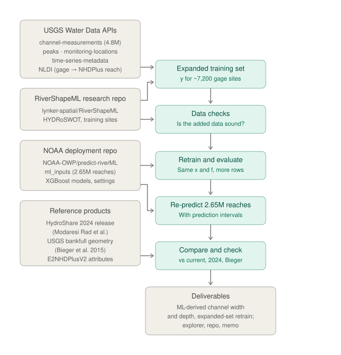
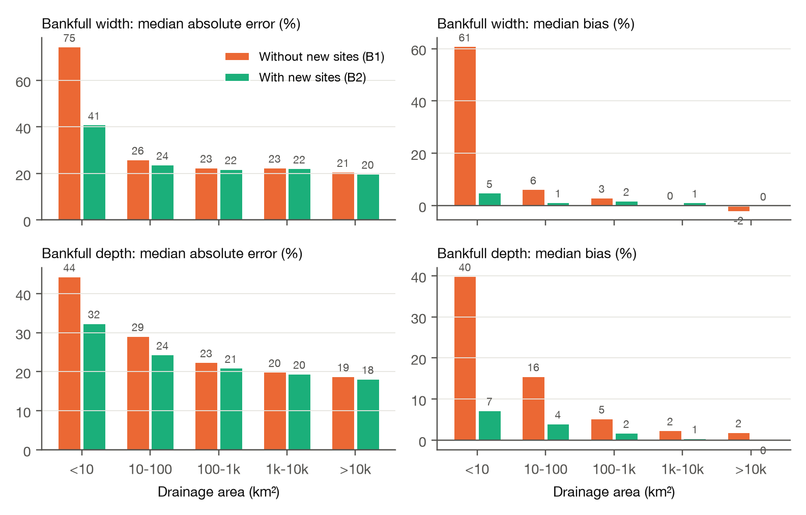
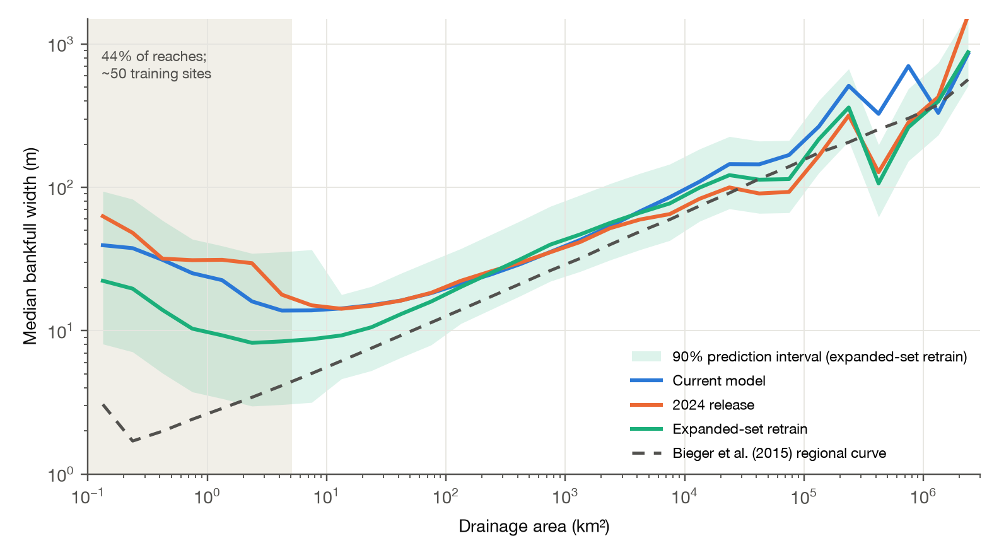

# Adding USGS channel measurements to RiverShapeML

*More gage sites, better-constrained targets, and a re-predicted national product with prediction intervals*

*Andrew Sommerlot · andrewsommerlot@gmail.com · October 2026 · draft v2*

## Summary

RiverShapeML (Modaresi Rad et al., 2024) learns bankfull width and depth from gage measurements and
predicts them for all 2.65 million NHDPlus reaches in CONUS. Its training data come from HYDRoSWOT, which
holds acoustic Doppler (ADCP) measurements through 2014. USGS now publishes every channel measurement it
makes, by every method (wading, bridge, cableway, boat), through the Water Data OGC API: 4.77 million
records. I rebuilt the training targets from those records using the RiverShapeML and AHGestimation
conventions, kept the model, features and deployment pipeline unchanged, and asked one question: **does the
added data improve the model where it is weakest?**

- **More training sites, mostly where they were scarcest.** Bankfull-width training sites rise from 4,375
  to 6,928 (+58%). Sites under 10 km² rise from 66 to 111, and sites of 10–100 km² from 596 to 1,157.
- **The added measurements are sound.** Where non-ADCP and ADCP measurements were taken the same way at the
  same site and flow, widths agree within 0.1–2.4%.
- **Held-out error falls most in small streams.** For sites under 10 km², median absolute error in
  bankfull width falls from 74% to 41% and bias from +61% to +5% when the new sites are added. Overall
  error improves modestly (23.3% → 22.4%), and accuracy on the original HYDRoSWOT targets is unchanged.
- **A re-predicted national product with 90% prediction intervals.** The retrained model was run through
  the NOAA-OWP deployment pipeline for every reach, with split-conformal intervals by drainage-area class.
  It sits closer to the Bieger et al. (2015) regional curves in headwaters and removes most physically
  implausible values.

The work builds directly on Arash Modaresi Rad's RiverShapeML and the public
[NOAA-OWP/predict-riverML](https://github.com/NOAA-OWP/predict-riverML) pipeline, and uses Mike Johnson's
AHGestimation package for the target fits. The deployment pipeline is clean and complete enough that its
national outputs reproduced exactly from the published models, which made a controlled experiment like this
one possible in a few weeks.

## 1. Motivation

I walked a stretch of Shoal Creek in Austin, Texas, to see how a reach-averaged geometry product compares
with the channel on the ground. Over a few hundred meters the channel moves from a walled, rock-lined
section with a built low-flow channel, to an incised section held by gabions and a bedrock ledge, to a
section rebuilding a small floodplain below a failed grade control. A single bankfull value for the whole
8.2 km reach (COMID 5781223) is the right abstraction for a national product, so that variability is not
the subject here.

The gage at the downstream end of the walk is. USGS 08156675 (Shoal Creek at Silverway Drive) has
**68 width measurements**. HYDRoSWOT has **2**, both boat measurements from 2009, so the site falls below the
5-measurement minimum. The other 66, mostly wading measurements, are not in HYDRoSWOT at all. The question
this note answers is how common that situation is, and what the model gains when those measurements are
used.

*Figure 1. Process. Each box is a script in the accompanying repository, and the full table-level lineage
(35 tables, 17 operations, each with source, retrieval date and commit) is checked automatically on every
run.*

## 2. Data and methods

**Measurements.** All USGS channel measurements were retrieved from the `channel-measurements` collection
of the USGS Water Data OGC API (4,772,063 records), with site metadata and annual peaks from the
`monitoring-locations` and `peaks` collections. Gages were linked to NHDPlus reaches with the NLDI; existing
RiverShapeML sites keep their published COMIDs. Candidate new sites are CONUS gages with at least 5
measurements since 2000 and at least 10 years of daily flow (4,501 sites; 3,192 linked to a reach).

**Targets.** For each site, width, mean depth (area / width) and velocity were converted to SI units and
screened with RiverShapeML's sanity rules (width < 4 km, depth < 65 m, Q ≤ 1.1 × maximum annual peak).
Hydraulic geometry was then fit with AHGestimation (`mad_filter` → `qva_filter` → `ahg_estimate`), which
fits W = aQ^b, D = cQ^f and V = kQ^m jointly under continuity, and each curve was evaluated at the 2-year
flood, Q₂. I took Q₂ as the median of the annual peak series, which is the 2-year flood by definition on an
annual-maximum basis (England et al., 2019; Institute of Hydrology, 1999); it agrees with RiverShapeML's
fitted values at shared sites (median ratio 0.97). The target is y = ln(1 + W_bf) with W_bf in meters, as in
RiverShapeML, and likewise for depth. Sites where depth decreases with flow (f < 0) were dropped (53 sites).

**Target filter.** RiverShapeML keeps sites whose width–discharge fit has R² ≥ 0.6. Many well-measured
sites fail that test because width barely changes with flow, not because the target is uncertain: 3,636 of
the 6,928 width targets here would fail it, with a median standard error of 0.037 on the log target. I
replaced it with a precision filter: standard error of the log target at Q₂ ≤ 0.2, Q₂ ≤ 3 × the largest
measured flow (limits extrapolation), and at least 5 measurements.

**Model.** Features, feature engineering, missing-value handling and inference follow predict-riverML exactly
(30 features from `ml_inputs.parquet`). I first reproduced the deployed models' national predictions (width
median 18.27 m vs 18.43 m in their saved statistics; depth identical). For retraining I kept their XGBoost
learning rate and sampling settings but chose tree depth, minimum child weight and number of trees by a
regularization sweep with early stopping on a reach-grouped 70/15/15 split (depth 6, min_child_weight 5,
about 2,450 trees). This matched the deployed settings' held-out accuracy with roughly a quarter of the
trees and much less fit to the training data (test log R² 0.84 for width, 0.76 for depth). All runs below
use the same settings, so only the training data differ.

**Experiment.** Three training sets, scored with 5-fold cross-validation grouped by reach, repeated with 3
seeds:

| Run | Sites | Targets |
|---|---|---|
| A | Existing RiverShapeML sites | HYDRoSWOT measurements only |
| B1 | Existing RiverShapeML sites | All USGS measurements |
| B2 | B1 plus new sites | All USGS measurements |

B1 versus B2 isolates the value of new sites. As a reproduction check, all three runs are also scored
against HYDRoSWOT-only targets, to confirm that the added data do not degrade accuracy on the original
problem. Error is reported as ln(predicted / observed), summarized as median absolute error (%), median bias
(%), share of sites within a factor of 2, and R² in log space.

**Prediction intervals.** The B2 model was refit on all sites and applied to every reach through the
deployment pipeline. Split-conformal 90% prediction intervals (Lei et al., 2018) were computed per
drainage-area class from held-out residuals. Coverage was then checked on sites unseen by both the model and
the calibration (0.88–0.90 across classes).

## 3. Results

### More sites, concentrated in small drainages

| Drainage area (km²) | Width sites today (R² ≥ 0.6) | Expanded set: existing sites | Expanded set: new sites | Expanded total |
|---|---:|---:|---:|---:|
| < 10 | 66 | 38 | 73 | 111 |
| 10–100 | 596 | 560 | 597 | 1,157 |
| 100–1,000 | 1,766 | 1,919 | 876 | 2,795 |
| 1,000–10,000 | 1,395 | 1,620 | 465 | 2,085 |
| > 10,000 | 485 | 577 | 193 | 770 |
| **Total** | **4,375** | **4,719** | **2,209** | **6,928** |

Totals include 10 sites without a drainage area. Depth targets follow the same pattern (7,017 sites). The gain is largest relative to need: 58% of NHDPlus
reaches drain less than 10 km², and those reaches were represented by 66 training sites.

### The added measurements are consistent with HYDRoSWOT

On a 300-site sample, 97% of HYDRoSWOT measurements matched a record in the USGS collection (same day,
discharge within 3%), and a typical site has 13 HYDRoSWOT measurements against 142 in total. Where the same
deployment type appears in both, widths agree closely (bridge +0.1%, boat +2.4%, cableway +1.0%). Wading
measurements are about 33% narrower than bridge measurements at the same flows, because they are taken at
different cross sections; this is a location difference rather than an error, and AHGestimation's filters
and the joint fit absorb most of it. Repeat-measurement scatter sets a noise floor of 8–15% for width and
14–19% for depth. The joint AHG fit changes the median width target by less than 1% relative to a plain
log-log fit but corrects poorly conditioned sites (e.g., Walnut Creek: 28.1 m → 19.0 m).

### Held-out error falls most where data were added

*Figure 2. Held-out median absolute error and median bias by drainage-area class, without (B1) and with
(B2) the new sites. Same model settings, same held-out sites.*

| Bankfull width | Median abs. error | Within 2× | Bias | Log R² |
|---|---:|---:|---:|---:|
| A (HYDRoSWOT targets) | 25.4% | – | – | 0.766 |
| B1 (all measurements) | 23.3% | 90.5% | +2.4% | 0.790 |
| B2 (+ new sites) | 22.4% | 92.3% | +1.4% | 0.816 |
| B1 → B2, < 10 km² | 74.5% → 41.1% | 48% → 70% | +61% → +4.9% | 0.39 → 0.64 |
| B1 → B2, 10–100 km² | 26.2% → 23.9% | – | +6.3% → +1.3% | 0.43 → 0.56 |

For depth, overall error falls from 22.4% to 20.9% (log R² 0.715 → 0.762), and for sites under 10 km² from
44.5% to 32.5% (bias +40% → +7%). In the largest basins (> 10,000 km²) the change is small (width 20.8% →
20.0%), as expected where data were already plentiful. For context, the repeat-measurement noise floor
implies that no model can do much better than about 10–15% median error on width.

**Reproduction check.** Scored against the original HYDRoSWOT-only targets (3,658 sites), the three runs are
indistinguishable: median absolute error 20.8% (A), 20.3% (B1), 20.0% (B2); log R² 0.826, 0.813, 0.816. The
added data help on the broader target set without costing accuracy on the original one.

### A re-predicted national product

*Figure 3. Median bankfull width by drainage area across all CONUS reaches for the current model
(predict-riverML), the 2024 HydroShare release, the expanded-set retrain with its 90% prediction interval,
and the Bieger et al. (2015) regional curves. The shaded region holds 44% of reaches.*

| Check (all 2.6 M reaches) | Expanded-set retrain | Current model | 2024 release |
|---|---:|---:|---:|
| Width > 1 km | 0.002% | 0.47% | 0.013% |
| Width / depth > 100 | 0.09% | 1.94% | 0.05% |
| Width halves going downstream | 2.2% | 3.6% | 5.3% |
| Width–drainage-area exponent (Bieger: 0.36) | 0.23 | 0.15 | 0.06 |
| Depth–drainage-area exponent (Bieger: 0.25) | 0.16 | 0.12 | 0.00 |
| Median ratio to Bieger width | 1.84 | 2.88 | 3.28 |

Above 100 km² the three ML products agree closely (median widths within about 10%). Below 10 km² they
diverge: median widths are 9.1 m (expanded-set retrain), 17.6 m (current model), 26.5 m (2024 release) and
3.5 m (Bieger). Downstream scaling moves toward the regional curves, and implausibly wide reaches nearly
disappear. Prediction intervals are honest about where the model knows least: for width they span roughly
0.55–1.9× the prediction above 10 km² and 0.36–4.2× below it.

The Silverway reach illustrates both the improvement and its limit. The retrain predicts 15.8 m wide and
0.99 m deep (current model 14.8 m / 1.29 m; 2024 release 19.6 m / 1.51 m). The Silverway site itself is
not in the expanded training set: its Q₂ (2,700 cfs, 76 m³/s) is 5.2 times the largest measured flow, so
its target would be an extrapolation and the filter excludes it.

## 4. Discussion and limitations

**The headwater gap is narrower but not closed.** Below about 5 km² there are still only ~50 training sites
for 1.16 million reaches. Tree ensembles cannot extrapolate beyond the range of their training targets, so
predictions flatten (and in all three products bend upward) at the smallest drainage areas rather than
continuing the downstream trend. The ratio to Bieger widths remains 1.8 overall. Part of that gap is
definitional: Bieger's field bankfull indicators and a Q₂-based target are not the same quantity, and the
Q₂ convention likely overstates bankfull flow in small, flashy basins.

**Gaged is not ungaged.** All accuracy figures are for reaches with gages, which skew toward larger, more
stable, more often modified channels. The conformal intervals inherit that assumption: they are calibrated
on gaged sites and are exchangeable only to the extent that ungaged reaches resemble them.

**Some useful data remain unused.** About 1,300 candidate gages did not link to a reach through the NLDI, and
about 7,000 sites have five or more measurements but less than 10 years of daily flow. The latter could
use National Water Model flood frequencies, which the RiverShapeML codebase already supports; at gages
NWM-based Q₂ agrees well overall (log R² ~0.80) but less well under 10 km² (0.47), which argues for using it
with an uncertainty term.

**Two observations I could not resolve from the public record.** The current deployed models and the 2024
HydroShare release differ more than I expected (log R² ~0.35 for width between them), and the HydroShare
file contains about 65,000 duplicated reach IDs. Both are probably explained by a model update between
releases, and they are noted here as questions, not findings.

## 5. Questions and possible next steps

These are offered as starting points for a conversation; the team will know which matter and which have
already been considered.

1. **Was the HYDRoSWOT-only choice deliberate?** For example, to keep a single, consistent measurement
   method. The agreement statistics above suggest the other methods can be added with little risk, but
   there may be reasons I have not seen.
2. **Headwater behavior.** Monotone constraints on drainage area and discharge, or blending with regional
   curves below a threshold, would keep predictions on a physically sensible trend where data are sparse.
3. **More sites.** Recover the unlinked gages and add NWM-based flood frequencies for the ~7,000
   short-record sites.
4. **In-channel geometry.** The same measurements support targets at lower flows (in-channel flow is about
   6% of bankfull flow at the median), and these sites are far better sampled there than at Q₂. This is the
   natural next experiment and maps directly onto the existing in-channel model.
5. **Training settings.** Early stopping and modest regularization reach the same accuracy with about a
   quarter of the trees, which shortens training and inference.
6. **Release housekeeping.** An updated HydroShare release could carry prediction intervals, and the
   duplicate IDs noted above.

I would be glad to prototype any of these within the predict-riverML structure so that the results drop
straight into the existing pipeline.

## Code and data

Repository: github.com/drmerlot/rivershapeml-more-data (private; access on request). It contains every
script, a single `run_all.sh` that rebuilds all results from public sources, a checked data-lineage record,
an interactive notebook (marimo) for exploring sites, targets, runs and the national product, and the
re-predicted product ("ML-derived channel width and depth, expanded-set retrain") with 90% prediction
intervals for every reach.

## Acknowledgments

This work stands on Arash Modaresi Rad's RiverShapeML research and the NOAA Office of Water Prediction's
open [predict-riverML](https://github.com/NOAA-OWP/predict-riverML) deployment pipeline, whose published
models, inputs and inference code made exact reproduction straightforward. Target fitting uses
[AHGestimation](https://github.com/mikejohnson51/AHGestimation) by Mike Johnson, with contributions from
Arash Modaresi Rad. Data are from the USGS (HYDRoSWOT; Water Data APIs; NLDI), the E2NHDPlus attributes,
and the Bieger et al. (2015) regional curves (USGS ScienceBase). Any errors of interpretation are mine.

## References

- Bieger, K., Rathjens, H., Allen, P. M., and Arnold, J. G. (2015). Development and evaluation of bankfull
  hydraulic geometry relationships for the physiographic regions of the United States. *JAWRA*, 51(3),
  842–858. doi:10.1111/jawr.12282. Data: doi:10.5066/F7765D7V.
- Canova, M. G., Fulton, J. W., and Bjerklie, D. M. (2016). USGS HYDRoSWOT: USGS Hydroacoustic dataset in
  support of the Surface Water Oceanographic Topography satellite mission. U.S. Geological Survey data
  release. doi:10.5066/F7D798H6.
- Chen, T., and Guestrin, C. (2016). XGBoost: A scalable tree boosting system. *Proc. KDD*, 785–794.
- England, J. F., et al. (2019). Guidelines for determining flood flow frequency: Bulletin 17C. *USGS
  Techniques and Methods* 4-B5.
- Institute of Hydrology (1999). *Flood Estimation Handbook*, Vol. 3. Wallingford, UK.
- Johnson, J. M., et al. AHGestimation: An R package for computing robust, mass preserving hydraulic
  geometries and rating curves. github.com/mikejohnson51/AHGestimation.
- Lei, J., G'Sell, M., Rinaldo, A., Tibshirani, R. J., and Wasserman, L. (2018). Distribution-free
  predictive inference for regression. *JASA*, 113(523), 1094–1111.
- Leopold, L. B., and Maddock, T. (1953). The hydraulic geometry of stream channels and some physiographic
  implications. *USGS Professional Paper* 252.
- Modaresi Rad, A., et al. (2024). [title to confirm].
  *JGR: Machine Learning and Computation*. doi:10.1029/2024JH000173.
